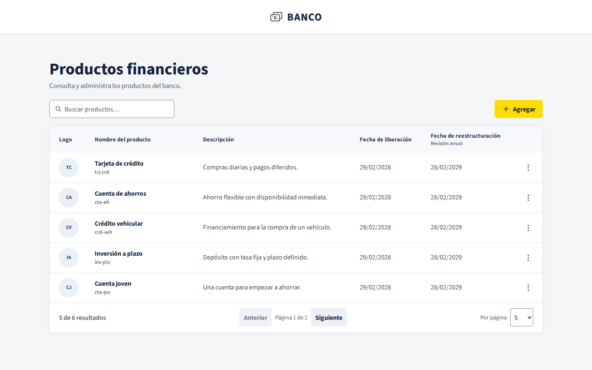

# Productos financieros

Catálogo de productos bancarios desarrollado con Angular 21 LTS y TypeScript. Permite listar, buscar, paginar, registrar, editar y eliminar productos. La interfaz utiliza HTML semántico y SCSS propio.



## Ejecutar el frontend

Requisitos: Node.js 22 LTS (22.12 o superior) y npm.

```sh
npm ci
npm start
```

Abrir [el catálogo local](http://127.0.0.1:4200). Para los recorridos con datos reales, la API proporcionada debe estar disponible. El proxy del frontend se configura en `proxy.conf.json`.

### Probar el formulario

Desde **Agregar**, ingresa un identificador libre como `visa001`, el nombre **Tarjeta Visa Signature**, una descripción de al menos diez caracteres y [esta imagen de ejemplo](https://www.visa.com.ec/dam/VCOM/regional/lac/SPA/Default/Pay%20With%20Visa/Tarjetas/visa-signature-400x225.jpg) como URL del logo. Elige la fecha de hoy o una posterior. La fecha de revisión se calcula al elegir la liberación.

La creación y la edición comparten las validaciones del formulario. El ID se comprueba antes de crear y queda bloqueado al editar. Si falla una petición, el formulario conserva los datos para que se puedan corregir o reintentar.

Al registrar, editar o eliminar un producto, aparece una confirmación con su nombre. Después de cinco segundos, el aviso se desvanece automáticamente. **Reiniciar** solicita confirmación cuando hay cambios pendientes.

## Pruebas y compilación

| Comando                 | Resultado                                              |
| ----------------------- | ------------------------------------------------------ |
| `npm test`              | Pruebas unitarias y de componentes con Jest            |
| `npm run test:watch`    | Pruebas en modo observación                            |
| `npm run test:coverage` | Cobertura en `coverage/`                               |
| `npm run test:ci`       | Tipado de pruebas, ejecución de Jest y umbral del 80 % |
| `npm run lint`          | Revisión de TypeScript y plantillas                    |
| `npm run format:check`  | Comprobación de formato                                |
| `npm run build`         | Compilación de producción en `dist/`                   |

Para las pruebas de navegador:

```sh
npx playwright install chromium firefox webkit
npm run test:e2e
```

La suite de interfaz usa respuestas controladas y ejecuta los recorridos en Chromium, Firefox y WebKit. Incluye auditorías automáticas de accesibilidad para listado, formulario y diálogo. El informe de navegador queda en `playwright-report/`.

Con la API proporcionada disponible, `npm run test:e2e:integration` recorre el CRUD real y limpia el registro de prueba que crea.

## Decisiones de implementación

- El dominio concentra las reglas de calendario, validación, búsqueda y paginación. La capa de aplicación define el contrato del repositorio y el adaptador HTTP traduce las respuestas a los modelos del catálogo.
- Angular Router carga las pantallas bajo demanda. La búsqueda y la paginación viven en la URL para preservar el contexto al editar.
- El formulario usa Reactive Forms tipados. Las fechas se manejan como días de calendario y la revisión se calcula por año. El 29 de febrero pasa al 28 cuando el siguiente año no es bisiesto.
- Las escrituras ambiguas se verifican antes de ofrecer un nuevo intento. La interfaz diferencia una carga, un catálogo vacío, una búsqueda sin coincidencias y un error.
- El listado móvil mantiene las acciones a mano y permite desplazar la tabla para consultar todas las columnas. Los formularios se reorganizan en una columna.

## Capturas

| Recorrido          | Evidencia                                                                                                                               |
| ------------------ | --------------------------------------------------------------------------------------------------------------------------------------- |
| Listado y acciones | [Listado](docs/capturas/01-listado.png) · [Menú](docs/capturas/02-menu.png) · [Eliminación](docs/capturas/03-eliminacion.png)           |
| Formulario         | [Registro](docs/capturas/04-registro.png) · [Validaciones](docs/capturas/05-validaciones.png) · [Edición](docs/capturas/06-edicion.png) |
| Estados de listado | [Carga](docs/capturas/07-carga.png) · [Vacío](docs/capturas/08-vacio.png) · [Error](docs/capturas/09-error.png)                         |
| Móvil              | [Listado](docs/capturas/10-listado-movil.png) · [Formulario](docs/capturas/11-registro-movil.png)                                       |

Tipografía [Source Sans 3](https://github.com/adobe-fonts/source-sans), distribuida con su [licencia OFL](public/fonts/OFL.md).

## Resultados de verificación

- **65 pruebas** unitarias y de componentes aprobadas.
- **39 pruebas** de navegador aprobadas en Chromium, Firefox y WebKit, incluida la revisión automatizada de accesibilidad.
- **1 recorrido de integración** aprobado contra la API real.
- Revisión visual adicional en Edge, con capturas de escritorio y móvil.
- Bundle inicial de producción de **264,58 kB**, con transferencia estimada de **73,16 kB**.

| Métrica de Jest | Cobertura |
| --------------- | --------: |
| Líneas          |   95,69 % |
| Sentencias      |   94,08 % |
| Funciones       |   96,59 % |
| Ramas           |   85,30 % |
